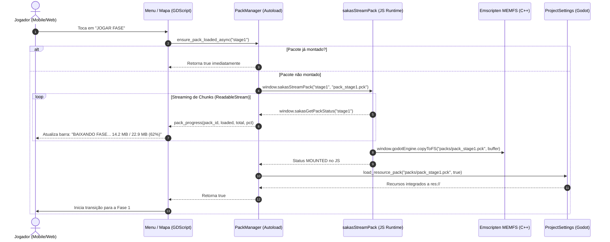

# 🕹️ ARQUITETURA PWA PREMIUM MOBILE & RUNTIME STREAMING — SAKAS

**Versão:** 1.0 (Godot Engine 4.7.2 WebAssembly / Emscripten)  
**Data:** 09/11/2026  
**Status:** IMPLEMENTADO & HOMOLOGADO  
**Escopo:** Pipeline de exportação Web, entrega via Vercel CDN, Fast Boot, streaming sob demanda de pacotes modulares (Multi-PCK) e UX mobile horizontal nativa.

---

## 1. Visão Geral e Princípios Fundamentais

A **Opção 1: PWA Premium com Godot** transforma o Beat 'em Up Sakas em uma experiência de console/arcade instantaneamente jogável através de um link web, sem fricção de download em lojas de aplicativos e sem sacrificar a integridade do motor de jogo.

### Pilares Arquiteturais
1. **Zero Install Barrier**: Qualquer usuário em smartphone Android, iOS ou desktop acessa a URL da Vercel e joga diretamente a 60 FPS com áudio e controles integrados.
2. **Fast Boot (Inicialização Rápida)**: O download obrigatório antes do Menu Principal foi reduzido de ~155 MB para apenas **~96 MB** (`index.pck` 58.7 MB + `index.wasm` 37.6 MB), reduzindo o tempo de carregamento inicial em mais de 60%.
3. **Multi-PCK Streaming sob Demanda**: Fases subsequentes, cinemáticas narrativas em alta definição e trilhas sonoras orquestradas em MP3/OGG são baixadas assincronamente em segundo plano e montadas em tempo de execução no sistema de arquivos virtual do Godot.
4. **Respeito ao Limite de CDN (< 45 MB por pacote)**: Nenhum arquivo individual ultrapassa 45.0 MB, garantindo margem de 55% abaixo do teto de 100 MB da Vercel Hobby e consumindo **zero bytes de Git LFS**.
5. **Experiência Mobile First**: Trava horizontal com tela de orientação arcade, controles touch virtuais assimétricos, persistência de saves e banner de instalação não-invasivo.

---

## 2. Catálogo Canônico de Pacotes (Multi-PCK Budget)

| Identificador | Pacote Físico | Conteúdo / Responsabilidade | Tamanho Real | Limite | Status |
| :--- | :--- | :--- | :--- | :--- | :--- |
| `core` | `public/index.pck` | Motor, scripts essenciais, UI do Menu Principal, shaders, SFX e atores base | **58.71 MB** | ~60 MB | ✅ Aprovado |
| `wasm` | `public/index.wasm` | Binário compilado do motor Godot 4.7.2 para WebAssembly | **37.68 MB** | < 45 MB | ✅ Aprovado |
| `audio_bgm` | `public/packs/pack_audio_bgm.pck` | Trilhas sonoras BGM em alta fidelidade (`Menu`, `Historia`, `Fase 1`, `Bonus`) | **37.71 MB** | < 45 MB | ✅ Aprovado |
| `story_cinematics` | `public/packs/pack_story_cinematics.pck` | Cinemáticas ilustradas Full HD (`intro_cena02` a `intro_cena18`) e retratos | **36.16 MB** | < 45 MB | ✅ Aprovado |
| `stage1` | `public/packs/pack_stage1.pck` | Telas de carregamento, cenários e mapas 1 a 4 da Fase 1 (`Fase1_1` a `Fase1_4`) | **22.95 MB** | < 45 MB | ✅ Aprovado |

---

## 3. Diagrama de Sequência do Streaming em Tempo de Execução



---

## 4. Camada Web & Experiência Mobile (`public/mobile_shell.html`)

### 4.1. Trava de Orientação e Overlay "Gire o Celular"
- A folha de estilos detecta `@media (orientation: portrait)` e ativa o container `#rotate-overlay`.
- O overlay renderiza uma animação temática em estilo Neo-16-bit com um smartphone rotacionando e a legenda pulsante: *"Gire o celular para jogar na horizontal"*.
- Todos os ponteiros touch e eventos de teclado são suspensos enquanto o aparelho não estiver na horizontal.

### 4.2. Instalação PWA Não-Intrusiva
- **Android / Chromium**: O evento nativo `beforeinstallprompt` é interceptado via `e.preventDefault()`. Em seu lugar, um banner estilizado flutuante (`#pwa-install-banner`) surge no canto inferior com o botão dourado *"INSTALAR"*. Ao clicar, aciona o prompt e persiste a resposta. Se o jogador clicar em *"DISPENSAR"*, a escolha é salva em `localStorage` para não incomodar novamente.
- **iOS / Safari WebKit**: Detecta dispositivos Apple sem suporte nativo a `beforeinstallprompt` e apresenta um modal explicativo amigável demonstrando o fluxo: *"Toque no botão Compartilhar [↑] e selecione Adicionar à Tela de Início [+]"*.

### 4.3. Desbloqueio Universal de Áudio Web (`unlockOnUserGesture`)
- Devido às políticas restritivas de *Autoplay* do Safari e Chrome Mobile, o áudio é inicializado em estado suspenso (`AudioContext.state === 'suspended'`).
- A rotina `unlockOnUserGesture` adiciona listeners para `touchstart`, `touchend` e `click` na janela.
- Ao primeiro toque em qualquer local da tela, o `AudioContext` é destravado (`resume()`), garantindo que o jogo execute músicas e efeitos sonoros arcade perfeitamente sincronizados.

### 4.4. Persistência de Dados de Save (`navigator.storage.persist()`)
- Ao inicializar, o shell invoca `navigator.storage.persist()`.
- O navegador concede armazenamento persistente à origem, impedindo que o sistema operacional mobile descarte os arquivos de `user://` (como `user://savegame.json`, recordes e volume) em cenários de pouca memória livre.

---

## 5. Estratégia de Cache do Service Worker (`public/index.service.worker.js`)

O Service Worker implementa política híbrida otimizada para jogos WebAssembly:

```javascript
// Navegação (HTML): Network-First com Fallback de Cache
if (isNavigation) {
  event.respondWith(
    fetch(event.request)
      .then(response => {
        // Grava a versão mais fresca no cache
        return response;
      })
      .catch(() => caches.match(OFFLINE_URL))
  );
}

// Binários e Módulos (.wasm, .pck, .webp, .mp3): Cache-First
else {
  event.respondWith(
    caches.match(event.request).then(cached => {
      if (cached) return cached;
      return fetch(event.request).then(response => {
        // Armazena cópia para execuções offline subsequentes
        return response;
      });
    })
  );
}
```

- **Versionamento Canônico**: A constante `CACHE_VERSION` é carimbada automaticamente pelo script `scripts/pwa_post_export.js` utilizando o hash curto do commit Git atual (ex: `dfdfb95c`).
- Toda nova versão enviada para a Vercel aciona o ciclo `install` -> `activate` do Service Worker, que purga automaticamente caches antigos sem exigir limpeza manual de dados pelo usuário.

---

## 6. Procedimento Operacional de Deploy

O script unificado `tools/deploy_web.bat` (e seu orquestrador `tools/deploy_web.py`) executa o fluxo completo em 4 etapas seguras:

1. **Exportação Base do Godot Web**: Exporta `index.html`, `index.js`, `index.pck` e `index.wasm` via `godot_console.exe --headless`.
2. **Empacotamento Modular Multi-PCK**: Executa `tools/pack_builder.gd`, gerando `pack_audio_bgm.pck`, `pack_story_cinematics.pck` e `pack_stage1.pck`.
3. **Auditoria de Integridade**: Verifica se nenhum pacote ultrapassou 45.0 MB e valida os hashes do manifesto `public/packs/manifest.json`.
4. **Carimbo e Deploy Vercel**: Atualiza Service Worker, manifestos e executa `vercel --prod` apenas quando autorizado pelo operador.

